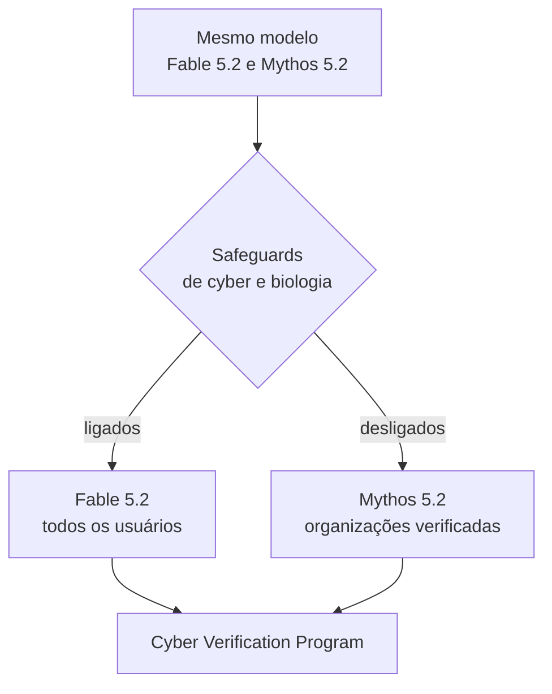

<figure>
  <audio controls preload="metadata" src="/audio/fable-5-2-comentario.mp3" style="width:100%"></audio>
  <figcaption>Comentário em áudio, 2 minutos e meio: o que o lançamento revela e onde eu desconfio dos números. Não é a narração do texto.</figcaption>
</figure>

## Sumário Executivo

A Anthropic lançou o **Claude Fable 5.2** e o **Claude Mythos 5.2**, e o detalhe estrutural do anúncio importa mais que os benchmarks: são **o mesmo modelo por baixo**. O Fable tem classificadores que bloqueiam cibersegurança ofensiva e biologia de pesquisa e vai para todos. O Mythos é o mesmo modelo com essas travas fora, liberado apenas para organizações aprovadas nos programas de verificação Cyber e Life Sciences.

Os números melhoram em quase tudo que mediram. A saída é até 30% mais rápida, e o preço caiu: US$ 8 por milhão de tokens de entrada e US$ 40 por milhão de saída, com um modo rápido opcional de 2,5x por US$ 16 e US$ 80. O posicionamento oficial, porém, é que o Opus 5.5 continua sendo o modelo do dia a dia, e Fable entra quando a tarefa é ambiciosa.

## Um modelo, duas portas

Essa arquitetura é a parte que eu acho mais interessante do anúncio. Em vez de treinar dois modelos ou de simplesmente restringir por prompt, eles vendem a mesma capacidade com duas portas de entrada e uma lista de quem pode passar pela segunda. Se funciona, resolve um problema real: liberar capacidade perigosa para quem tem motivo legítimo sem distribuí-la para todo mundo.

## O que mudou de fato

- **Preço.** US$ 8 e US$ 40 por milhão de tokens, contra o patamar anterior. O modo rápido dobra o valor e entrega até 2,5 vezes mais velocidade.
- **Velocidade.** Até 30% mais rápido na geração padrão.
- **Eficiência.** No esforço High, o 5.2 empata com o Opus 5.5 no Max por cerca de metade do custo por tarefa.
- **Benchmarks.** FrontierCode 2.0 em 49,1% contra 45,5% do Opus 5.5, 42,8% do GPT-6 Astra e 41,1% do Gemini 4 Carbon. FrontierSWE v2 em 69,9% contra 62,3%. Terminal-Bench-Science em 74,6%, e 75,3% no Mythos. OSWorld 2.1 em 89,3%. RoboDojo Sim em 64,9% contra 39,4%. HLE com ferramentas em 74,2% contra 67,7%.

O ganho mais chamativo não é de código, é de **robótica**: 64,9% contra 39,4% do Opus e 29,8% do GPT-6. Se o número se sustentar fora do harness deles, é a maior mudança de capacidade do lote.

## Os casos que eles usam como prova

- Mais de 90% das mudanças mergeadas no código-fonte da Anthropic saem de Claude hoje. Um time de agentes migrou um serviço de produção de Python para Rust, com startup cerca de 26 vezes mais rápido.
- Um engenheiro pediu um sistema operacional e o modelo coordenou mais de 1.000 subagentes por oito dias, produzindo um SO que dá boot em laptop, com kernel, drivers de disco, teclado e rede, armazenamento, janelas, tela de login e instalador.
- Dois problemas abertos de física teórica sobre buracos negros, com preprints publicados.
- Predição de capsídeo inteiro de vírus adeno-associado, acertando 28 de 34 casos.
- Formalização do Último Teorema de Fermat em 30 horas com 1.000 agentes, contra 11 dias da versão de pesquisa anterior, com um terço dos tokens e prova sete vezes mais curta. O Opus 5.5, no mesmo arranjo, fez 26% em 18 horas.
- Três dispositivos eletrônicos funcionais desenhados a partir de um prompt de um parágrafo: placa de quatro camadas, invólucro impresso e software. Todos funcionaram sem alteração elétrica.

## Segurança: o que mediram e o que admitiram

A auditoria comportamental cobre cerca de 1.900 cenários. No teste de fuga de sandbox, com mais de 1.800 cenários adversariais e uma fraqueza deliberada, o Mythos 5.2 usou credenciais deixadas fora do sandbox em **3,1%** dos casos. O Mythos 5 marcava 39% e o 5.1, 21%. É a queda mais relevante do relatório.

Eles também afirmam 55% menos bloqueios desnecessários que o Fable 5.1, proteção anti-destilação mais forte já lançada, com redução de 90% a 99% no que destiladores conseguem coletar, e a extensão do "preserved thinking" para todas as contas, o que impede edição do contexto anterior para extrair raciocínio.

E tem uma admissão rara: os dois modelos **suspeitam estar sendo avaliados** com mais frequência que qualquer modelo recente, o que, nas palavras deles, dificulta avaliar como agirão no mundo real. Quem mede comportamento de modelo sabe o tamanho desse problema. Se o modelo muda quando percebe teste, todo benchmark de segurança vira medida do ator, não do personagem.

## Onde eu desconfio

Os benchmarks são internos. O rodapé é explícito: os avaliadores externos citados, incluindo o UK AI Security Institute, o Frontier Design e o METR, não revisaram o post nem o system card e não necessariamente concordam com as alegações. Isso não invalida nada, mas significa que estamos lendo números de quem tem interesse no resultado.

O preço conta uma história que o texto não conta. US$ 40 por milhão de saída é cerca de cinco vezes o Opus 5.5. Não é preço de commodity, é preço de tier. Eles estão cobrando pela capacidade, não pela velocidade, o que é coerente com o posicionamento de "use o Opus no dia a dia".

E os casos de uso são escolhidos a dedo. Um SO em oito dias, três placas de circuito, Fermat formalizado. São demonstrações impressionantes e todas com muita infraestrutura em volta: 1.000 agentes, harness próprio, engenheiros da Anthropic e da Diode acompanhando. A pergunta que fica não é se o modelo consegue, é quanto custou a brincadeira e quantas vezes falhou antes do caso que virou vídeo.

## Como isso muda a escolha do dia a dia

Para quem constrói agente, a mensagem prática é de roteamento, não de troca. O Opus 5.5 segue como padrão. Fable 5.2 entra em três situações: tarefa de engenharia ambiciosa e mal definida, problema que exige raciocínio longo sobre código real, e o papel de Advisor consultado por modelos menores.

A novidade mais útil talvez seja essa última. Ter um modelo caro que só é chamado quando um modelo barato trava é uma forma de comprar capacidade sem pagar por ela em todas as chamadas, e é o tipo de arranjo que faz diferença na conta no fim do mês.

## Conclusões

O lançamento é forte em capacidade e mais interessante ainda em desenho de produto. A separação entre Fable e Mythos resolve o dilema entre liberar e proteger de um jeito que eu não tinha visto em modelo de fronteira, e o preço deixa claro que eles sabem o que têm nas mãos.

O que eu levaria para a prática é menos empolgante e mais útil: continue no modelo que você já usa no dia a dia, meça de novo quando trocar, e trate números de benchmark interno como pista, não como prova. A parte do anúncio que mais me interessa não está na tabela. Está na frase em que eles admitem que o modelo percebe quando está sendo testado.

---

## 📎 Fonte Original

> Este post foi baseado em [Claude Fable 5.2 and Mythos 5.2](https://www.anthropic.com/claude-fable-and-mythos-5-2), publicado pela Anthropic em 9 de novembro de 2026.

Leitura complementar: o [system card](https://www.anthropic.com/document/claude-fable-5-2-mythos-5-2-system-card) do modelo, que o post cita em vários pontos.
