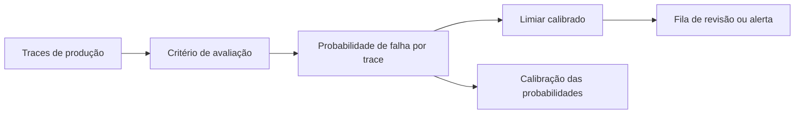

## Sumário Executivo

Saiu uma classe nova de modelo, os **modelos de decisão**: Jev (TypeSafe), Decider (Perplexity), d1 (Liquid), Clef (Cloudflare) e Decisions (OpenAI). Eles não conversam. Recebem uma pergunta fechada e devolvem a probabilidade de cada resposta. Para eval binário, isso é tudo que você precisa, e custa uma fração de um LLM judge.

Hamel Husain e Antaripa Saha testaram seis desses modelos numa tarefa real de suporte, com 98 traces rotulados por humanos. O achado central não é "qual modelo ganhou". É que a maioria das pessoas usa o limiar padrão de 0,50 sem olhar, e isso joga desempenho no lixo. Eles mostram como escolher o limiar por precisão e recall mínimos, como comparar custo e desempenho, e como verificar se a probabilidade devolvida significa alguma coisa.

Este texto comenta o artigo deles, com o que eu considero a parte mais subestimada (calibração), o que fica de fora (latência, tamanho da amostra) e o complemento do Randy Olson sobre quando um modelo de decisão substitui um LLM.

## O que é um modelo de decisão

Um LLM judge recebe um prompt em linguagem natural e devolve uma avaliação. Para virar número, alguém precisa pedir JSON, tratar o parse, lidar com resposta em prosa fora do formato. Um modelo de decisão nasce resolvendo isso: a saída é tipada, com uma probabilidade por alternativa.

O ponto de arquitetura é que o eval deixa de ser um chat e passa a ser um classificador. Isso muda as perguntas: qual o custo de um falso positivo, qual o custo de um falso negativo, qual volume por dia, qual latência aceitável.

## O experimento

O dataset são 100 traces de um agente de locação de imóveis, com dois exemplos internos de QA removidos, sobrando 98. Desses, 61 contêm falha confirmada por revisão humana e 37 não. A tarefa é ampla de propósito: decidir se o trace tem pelo menos um problema substantivo.

Os modelos testados foram Jev 1.13, Perplexity Decider 1.1 27B, Liquid d1 e d1-ultra, Cloudflare Clef Flash e OpenAI Decisions, este último usando GPT-6 Luna. Todos receberam o mesmo critério, e o apêndice do artigo traz o prompt completo, o que é raro e vale a leitura.

## A armadilha do 0,50

O exemplo do artigo é cirúrgico. Um modelo pode dar nota 0,40 para toda falha e 0,10 para todo acerto. Nesse mundo, um limiar de 0,30 acerta tudo e o padrão de 0,50 não pega nada. Não é hipótese: é o que acontece quando alguém assume que a nota é comparável entre modelos e tarefas.

Baixar o limiar pega mais falhas e gera mais alarme falso. Subir faz o contrário. Quem decide onde ficar é o custo do erro, não a estética da métrica. O artigo usa duas analogias que explicam bem: tribunal criminal, onde condenar inocente é caro e a exigência é alta, e triagem de câncer, onde o rastreamento aceita mais falso positivo para não perder caso.

## Tunar sem se enganar

A receita deles tem três exigências que a maioria pula.

Primeiro, definir o piso aceitável antes de olhar o resultado. No exemplo, 80% de precisão e 80% de recall no mínimo, porque o uso é alerta automatizado e ninguém quer encher a fila de alarme falso.

Segundo, escolher o limiar **no treino** e medir **na validação**. Eles usam validação cruzada estratificada em cinco folds, com os mesmos splits para todos os modelos. Limiar escolhido sobre o mesmo dado que gerou a nota é overfitting com outro nome.

Terceiro, aceitar quando não existe limiar que atenda. Isso aconteceu em 36 dos 100 splits de treino com o Perplexity e em 29 com o d1-ultra, e em nenhum com o OpenAI. O artigo registra o split como inviável em vez de afrouxar a meta. Essa honestidade é o oposto do que se vê em comparação de fornecedor.

## Custo contra desempenho

Depois de tunado, o Perplexity Decider saiu com F1 0,79 a **0,82 centavo por 100 evals**. O OpenAI Decisions chegou a F1 0,87 a **3,72 centavos por 100 evals**, cerca de 4,5 vezes o custo.

A leitura fácil é "o caro é melhor". A leitura útil é que a fronteira de Pareto depende do seu uso. Se o eval roda em cada conversa de um produto com milhões de mensagens, a diferença de 4,5x é o projeto inteiro. Se roda em auditoria semanal de 200 traces, é troco. O artigo usa F1 porque precisão e recall tinham peso igual no exemplo, e faz questão de dizer que quase nunca é o caso. F-beta resolve: beta abaixo de 1 prioriza precisão, acima de 1 prioriza recall.

## A parte subestimada: a probabilidade significa algo?

Aqui está o que eu levaria do artigo para qualquer sistema de eval. Se você usa o score como confiança para decidir o que revisar, o número precisa ter significado. Nota 0,80 deveria indicar que cerca de 80% dos traces parecidos com aquele contêm falha.

No teste, vários modelos não passaram. Um grupo de traces do Clef Flash tinha probabilidade média de falha de 8%, e 60% deles continham falha. É uma diferença de ordem de grandeza entre o que o número promete e o que acontece.

A correção é calibração, no artigo feita com Platt scaling: uma curva ajustada sobre os rótulos para transformar score em probabilidade. Funcionou para Perplexity, d1 e Clef, mexeu pouco em Jev e d1-ultra, que já eram bem calibrados, e **piorou** para o OpenAI, com Brier subindo de 0,159 para 0,164. Detalhe importante: refazer o ajuste sobre as probabilidades em vez do log-odds deu 0,154 ao OpenAI. Calibração também é escolha de método, e escolha se mede.

## O que eu tiro disso

Três coisas, na ordem em que mudam meu trabalho.

**Tunar limiar é grátis.** Os scores ficam salvos, o ajuste não chama modelo de novo. Quem compara modelos pelo limiar padrão está comparando a decisão de outra pessoa, não a capacidade do modelo.

**Calibração só importa quando o score vira ação.** Se o eval serve para bloquear deploy ou priorizar revisão, probabilidade errada custa dinheiro. Se serve só para contar falhas por semana, o ranking basta. Vale decidir isso antes de investir em Platt scaling.

**Eval é problema de classificador, e a área de ML já resolveu isso.** Precisão, recall, F-beta, curva ROC, calibração, Brier. Nada disso nasceu em 2026. O que nasceu é a facilidade de transformar trace de agente em rótulo binário com custo baixo. Quem vem de ciência de dados tem vantagem aqui, e o artigo diz isso sem rodeio.

## O que fica de fora

O dataset é de um domínio, com 98 traces, e a própria conclusão dos autores é que o desempenho varia muito entre tarefas e datasets. Uma amostra desse tamanho dá direção, não intervalo de confiança apertado. A calibração com cinco grupos de 19 ou 20 traces tem o mesmo limite: mostra se a curva está torta, não estima a taxa exata de falha futura.

Latência ficou fora por decisão de escopo, e é uma pena, porque muda a escolha em produção. As médias citadas em nota (1,56 s no d1-ultra, 7,85 s no Perplexity) vêm de execuções separadas e os autores avisam que não servem para comparar.

E existe a questão de maturidade: Jev 1.13 foi anunciado em setembro de 2026. Modelos com semanas de vida ainda não têm histórico de estabilidade, mudança de comportamento entre versões ou política de preço. Vale manter a suíte de avaliação para re-testar a cada release, não escolher uma vez e esquecer.

## O complemento do Randy Olson

O artigo do Hamel responde "como usar bem". O do Olson responde "quando usar". Ele olhou o Decision Index da Artificial Analysis, com 11 modelos de decisão e 15 configurações de LLM em quatro tarefas.

O resultado: LLM ganha com folga em conhecimento e raciocínio. Nas tarefas de escolha fixa, os dois grupos empatam. O melhor modelo de decisão vence todos os LLMs em classificação de segurança, e em roteamento de tool call só o Claude Opus 5.5 fica à frente, a 50 vezes o custo por tarefa. Modelos de decisão também respondem mais rápido.

A recomendação dele é a que eu adotaria: modelo de decisão na frente, para roteamento, triagem, moderação e decisão de usar ou não uma ferramenta, quando a informação necessária já está na entrada. LLM atrás, para o que depende de fato externo ou raciocínio em várias etapas. Híbrido, não substituição.

## Como aplicar

1. Defina uma falha por eval. Tarefa ampla esconde diferença de modelo, mas judge por modo de falha rende mais na prática.
2. Rotule à mão uma amostra pequena e honesta. Sem rótulo humano, não existe precisão nem recall, só opinião.
3. Escolha o piso de precisão e recall pelo custo do erro, antes de ver qualquer resultado.
4. Tune o limiar no treino, valide em outro conjunto, e registre quantos splits ficaram inviáveis.
5. Meça calibração se o score for virar ação. Compare Brier antes e depois, e não presuma que a correção melhora.
6. Re-teste a cada release de modelo. Eval é ativo que envelhece.

## Conclusões

Modelo de decisão não é versão barata de LLM judge. É um classificador, com as vantagens e as obrigações de um classificador. A obrigação principal é escolher o limiar pelo custo do erro, e a vantagem é que isso custa zero quando os scores já estão salvos.

O que separa um eval útil de uma planilha bonita é a decisão que ele informa. Antes de discutir qual modelo tem o melhor F1, vale responder qual ação depende daquele número, quanto custa errar para cada lado e com que frequência o número precisa estar certo. O resto é ajuste.

---

## 📎 Fonte Original

> Este post foi baseado em [How To Use Decision Models for Evals](https://hamel.dev/blog/posts/decision-model-evals/), de Hamel Husain e Antaripa Saha (outubro de 2026).

Referências complementares:

- [When to use a decision model instead of an LLM](https://www.randalolson.com/2026/10/14/when-to-use-a-decision-model-instead-of-an-llm/), de Randal S. Olson.
- [Artificial Analysis Decision Index](https://artificialanalysis.ai/articles/artificial-analysis-decision-index), com a comparação entre modelos de decisão e LLMs.
- [A Field Guide to Rapidly Improving AI Products](https://hamel.dev/blog/posts/field-guide/), do mesmo autor, sobre análise de erro e evals binários.
- [Guia de calibração de probabilidade do scikit-learn](https://scikit-learn.org/stable/modules/calibration.html), para Platt scaling, regressão isotônica e Brier score.
