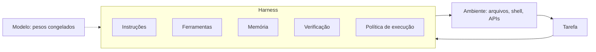
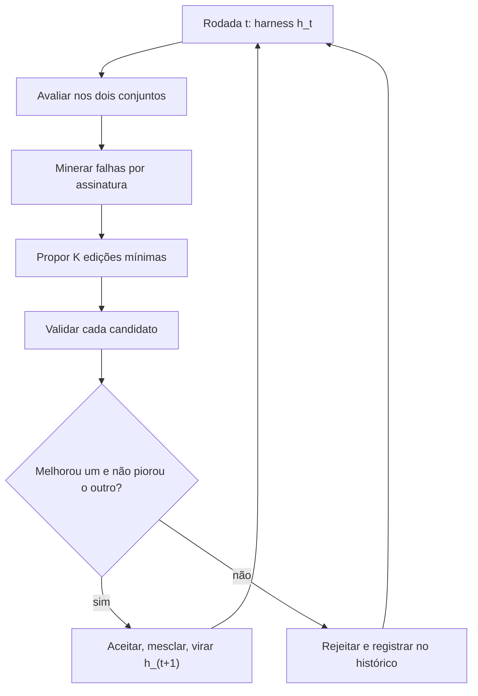
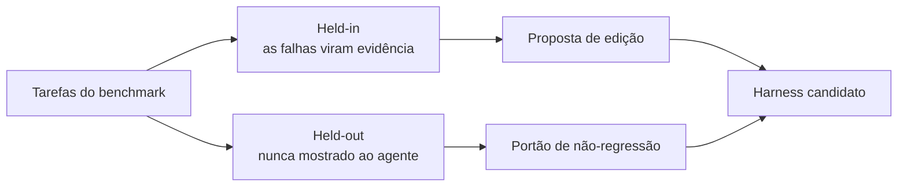

## Sumário Executivo

Um agente é modelo mais harness. O modelo é o motor; o harness é o resto do carro: prompt, ferramentas, memória, regras de verificação, política de execução, orquestração. O paper Self-Harness, do Shanghai AI Lab, testa se um modelo congelado consegue melhorar esse envelope sozinho, sem engenheiro humano e sem um modelo mais forte no papel de professor.

O experimento cobre nove combinações de três modelos e três benchmarks. Todas melhoraram. O maior salto absoluto foi o GLM-5 no AppWorld, de 44,4% para 85,0% de aprovação. O número mais interessante, porém, não é o ganho. É o método: cada edição nasce de falhas agrupadas por mecanismo e só entra se não piorar nenhum dos dois conjuntos de teste.

## O que é harness, e por que ele decide o resultado

Dois agentes com o mesmo modelo e o mesmo orçamento podem ter desempenhos muito diferentes. A diferença mora na camada que não é peso: instruções de etapa, ferramentas disponíveis, memória, checagens antes de concluir, limite de chamadas, orquestração de subagentes.

O paper insiste nesse ponto. Muitas falhas importantes de agente não são falhas do modelo, são falhas da camada de fora. O agente diz que concluiu sem conferir o arquivo que precisava entregar. Repete o comando que já falhou. Perde o fio da meada no meio de um contexto longo. Nada disso se resolve escrevendo um prompt mais bonito.

O problema é que essa camada é escrita à mão, e cada modelo tem tiques próprios. Um explora demais antes de agir. Outro instala dependência e perde a configuração entre comandos de shell. Com modelos novos saindo toda hora, reajustar o harness para cada um não escala.

## O laço em três etapas

A mineração é a parte que merece atenção. Em vez de jogar os logs no modelo e perguntar o que está errado, o sistema agrupa as falhas por uma assinatura de três campos: a causa terminal que o verificador apontou, o status causal do comportamento do agente dentro do trace e o mecanismo abstrato que aquele trace expõe. Duas falhas só caem no mesmo grupo quando concordam nos três. O agrupamento é determinístico, não é similaridade semântica.

O motivo é prático. Timeout e arquivo ausente podem ter o mesmo sintoma e exigir consertos diferentes. Agrupar por sintoma gera remendo genérico; agrupar por mecanismo gera intervenção reutilizável.

Na etapa seguinte, o mesmo modelo, ainda sob o harness atual, recebe esse pacote e propõe um conjunto de edições distintas e mínimas. Cada proposta precisa dizer qual mecanismo ataca e qual superfície altera. Existe também um filtro de endereçabilidade: se a falha é limite de capacidade do modelo ou dificuldade da própria tarefa, a proposta deve ser descartada em vez de virar patch.

A validação é onde o método ganha disciplina. Cada candidato é avaliado nos dois conjuntos, e só é aceito se melhorar pelo menos um e não piorar nenhum. Trocar desempenho entre os conjuntos não conta como ganho, mesmo que a soma total suba.

## Held-in e held-out: a diferença entre melhorar e decorar

Pense na lista de exercícios e na prova. Se o aluno vai bem só na lista, você não sabe se ele aprendeu ou memorizou. O held-in é a lista: as falhas dele alimentam a proposta. O held-out é a prova: o agente nunca vê essas tarefas, elas servem apenas de portão contra regressão.

O harness não guarda respostas, mas pode decorar particularidades do ambiente. Onde fica o arquivo de resposta, qual é o nome do teste, em que porta o serviço sobe. Uma edição dessas sobe o held-in e não serve para nada fora do benchmark. O held-out é o filtro que separa uma coisa da outra.

## Resultados

- **Terminal-Bench-2.0**: MiniMax M2.5 de 42,2% para 53,9%, Qwen3.5-35B-A3B de 18,0% para 36,7%, GLM-5 de 46,1% para 57,0%.
- **SWE-bench Verified**: 46,0% para 52,5%, 19,5% para 41,5%, 52,0% para 55,5%.
- **AppWorld**: 48,6% para 58,9%, 22,5% para 52,2%, 44,4% para 85,0%.

O ganho cresce muito mais nos modelos mais fracos. O Qwen quase dobra no Terminal-Bench. Isso faz sentido: quanto mais o modelo patina em coisas consertáveis pela camada de fora, mais espaço existe para o harness compensar. A edição de harness tem teto, porque ela remove atrito de execução e não cria capacidade que o modelo não tem.

Em quatro das nove combinações, o ganho no held-out foi maior que o ganho no held-in. É o indício de que as edições pegaram mecanismos gerais, e não particularidades das tarefas vistas.

## O que cada harness aprendeu

- **MiniMax M2.5** entregava tarde e travava em loop. O harness final manda identificar o artefato exigido e criar uma primeira versão cedo, além de limitar mensagens de ferramenta para forçar redirecionamento.
- **Qwen3.5-35B-A3B** se perdia na recuperação de erro. O harness final pré-checa dependências, disciplina retry e injeta instrução quando uma ferramenta falha, voltando o foco para o artefato que falta.
- **GLM-5** não fazia a mudança de ambiente persistir e demorava a sair da exploração. O harness final exige que PATH e instalações sobrevivam entre sessões de shell e cobra a transição para implementação depois de um período explorando.

No AppWorld os três convergem para o mesmo tipo de correção: recuperar estado completo, com paginação até o fim, e acertar a semântica de conclusão. Tarefa de ação termina com estado mutado e resposta nula; tarefa de informação termina com resposta.

## Limites que o paper não resolve

- **O held-out é usado como portão e depois reportado como resultado.** Todo harness final foi escolhido por ter ido bem naquele conjunto, então o ganho de held-out está otimista. Some a isso um n pequeno, 33 casos no SWE-bench, sem intervalo de confiança. A conclusão sólida é a direção, nove de nove melhoraram, não a magnitude exata.
- **Custo não é reportado.** Cada rodada avalia K candidatos em dois conjuntos, com repetições. É caro em inferência e em tempo de máquina, e o paper não traz a conta.
- **K e T não são declarados.** O número de propostas por rodada e o número de rodadas não aparece no texto.
- **A edição é restrita.** O agente só mexe no arquivo de configuração que instancia o harness sobre o DeepAgent. É melhoria limitada e auditável, não evolução aberta.
- **Tudo depende do verificador.** Se a métrica é fraca, o laço otimiza para a métrica errada, com muita competência.

## Conclusões

A lição prática não é deixar o agente se reescrever. É tratar melhoria de harness como transição de estado verificável. Cada edição declara o comportamento que quer mudar, a superfície que altera, a evidência que a motiva e o resultado que justifica a promoção. Raciocínio plausível do proponente não é evidência.

Para quem constrói agente em produção, isso sugere quatro peças: um verificador barato e determinístico, dois conjuntos separados de tarefas, diagnóstico por mecanismo em vez de sintoma e um registro de linhagem de cada versão do harness. Sem a primeira, o resto é opinião de agente com boa redação.

---

## 📎 Fonte Original

> Este post foi baseado no paper [Self-Harness: Harnesses That Improve Themselves](https://arxiv.org/abs/2606.09498) (arXiv 2606.09498v3), de Hangfan Zhang, Shao Zhang, Kangcong Li, Chen Zhang, Yang Chen, Yiqun Zhang, Lei Bai e Shuyue Hu, Shanghai Artificial Intelligence Laboratory.
